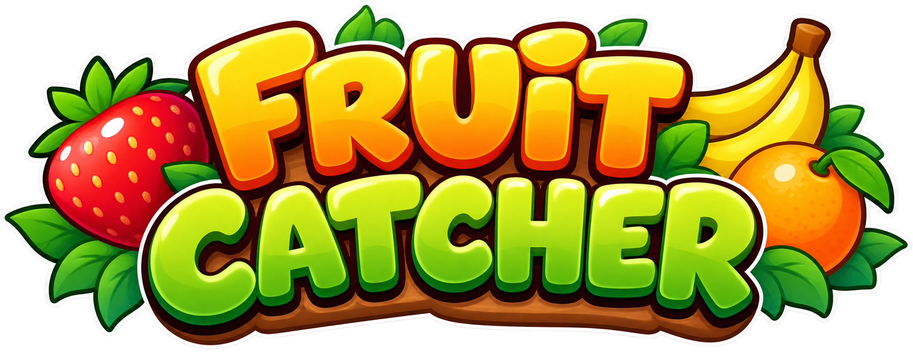
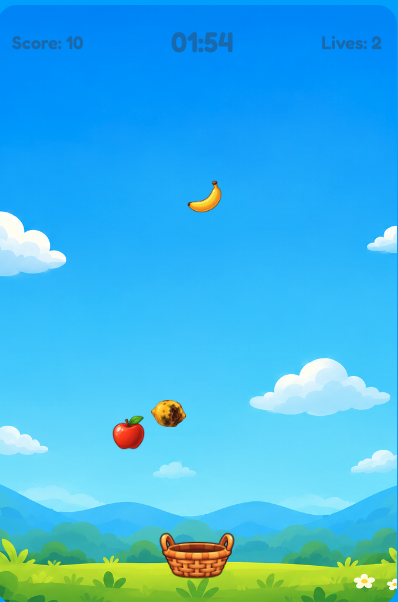
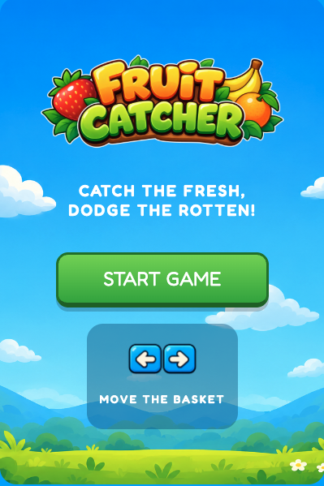
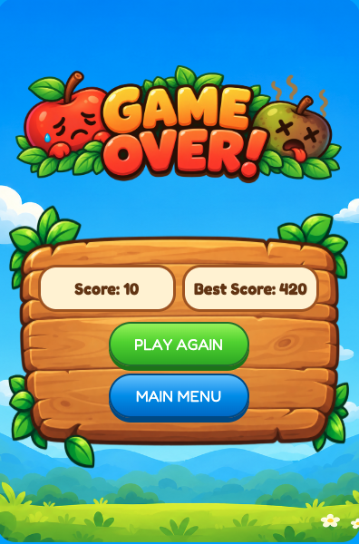

# Fruit Catcher

  

Fruit Catcher is a game built with JavaScript as part of the Ironhack Web Development Module 1 project.

**The Goal** 
To catch the fresh fruit to score 10 points and avoid the rotten fruits. If you miss a fresh fruit or catch a rotten one, you lose a life. Try to achieve the highest score possible in 2 minutes.

**Game Concept**

 - Targets appear randomly horizontally and fall vertically.
 - Each fresh fruit caught increases the score.
 - The game ends when the timer reaches zero or loses 3 lives.
 - The final score is displayed on a final score screen.
 - The best score is saved using localStorage.

  

**How To Play?**

Click on START GAME and move the basket horizontally using left and right arrows from the keyboard.

  

**Score screen - Displays:**

 - Final score
 - Stored best score
 - Restart button that allows the player to play again
 - A Main Menu button that allows the player to go back to the start screen

  

> Written with [StackEdit](https://stackedit.io/).